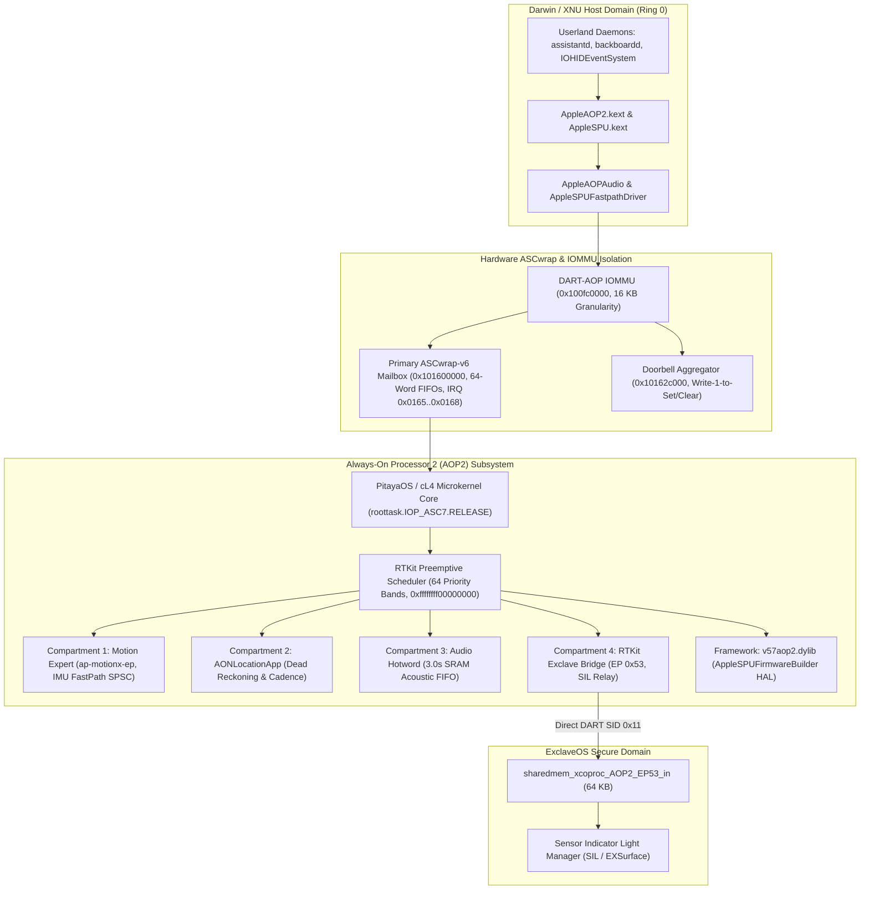

# Apple Always-On Processor 2 (AOP2), RTKit Microkernel & Sensor Hub Specification

[](#clean-room-statement)
[-orange.svg)](#key-invariants--parameters)
[-purple.svg)](#1-pitayaos--cl4-capability-microkernel-substrate)
[-brightgreen.svg)](#verification--independent-replication)
[](#key-invariants--parameters)
[](LICENSE)

An authoritative, clean-room architectural specification, preemptive microkernel execution model, continuous sensor fusion pipeline, and ultra-low-power hardware analysis for Apple's **Always-On Processor 2 (AOP2)**, **RTKitOS**, and **PitayaOS / cL4** on modern Apple Silicon (A19 Pro / `t8150` / `v57ap` / iOS 27.2 Build `24B119`).

---

## Table of Contents

- [Architectural Overview](#architectural-overview)
- [Key Invariants & Parameters](#key-invariants--parameters)
- [Deep Architectural Dissection](#deep-architectural-dissection)
  - [1. PitayaOS & cL4 Capability Microkernel Substrate](#1-pitayaos--cl4-capability-microkernel-substrate)
  - [2. Forensic Architecture Comparison: AOP1 (`aopf`) vs AOP2 (`aop2`)](#2-forensic-architecture-comparison-aop1-aopf-vs-aop2-aop2)
  - [3. Continuous Sensor Hub & Lock-Free SPSC FastPath Pipeline](#3-continuous-sensor-hub--lock-free-spsc-fastpath-pipeline)
  - [4. Reverse-Engineered C Struct Signatures](#4-reverse-engineered-c-struct-signatures)
  - [5. Pre-Kernel Audio Boot Tone Engine (`aubt`) & AppleAOPAudio](#5-pre-kernel-audio-boot-tone-engine-aubt--appleaopaudio)
  - [6. Always-On Display (1Hz AOD) & DeviceTree Optical Geometry](#6-always-on-display-1hz-aod--devicetree-optical-geometry)
  - [7. Cross-Enclave Tightbeam Relay (`EP 0x53`)](#7-cross-enclave-tightbeam-relay-ep-0x53)
- [Repository Structure](#repository-structure)
- [Verification & Independent Replication](#verification--independent-replication)
- [Clean-Room Statement](#clean-room-statement)
- [Citation](#citation)
- [License](#license)

---

## Architectural Overview

The **Always-On Processor 2 (AOP2)** operates as an independent, ultra-low-power compute enclave embedded directly into modern Apple Silicon SoCs (A19 Pro `t8150`). While the host Application Processor (AP) high-performance and efficiency CPU clusters (`Everest` / `Sawtooth`) and the AGX GPU sleep in deep retention states, AOP2 remains permanently powered.

AOP2 executes a 64-bit preemptive microkernel (`RTKitOS / Yggdrasill` built on **PitayaOS / cL4**, target: `armv8_cl4_Oz_flto_pac`) compiled for **ARM64e with Pointer Authentication (`PAC00`)**. It directly arbitrates high-speed sensor streams (6-axis IMU, TrueTone ALS, barometer, capacitive controls), streams 1Hz Always-On Display (AOD) frames to the Display Co-Processor (DCP), maintains an always-listening Voice Activity Detection (VAD) buffer in retention SRAM (< 1.85 mW), and establishes a hardware-isolated Tightbeam bridge to **ExclaveOS** for tamper-proof Sensor Indicator Light (SIL) privacy reporting.



---

## Key Invariants & Parameters

| Parameter | Value | Verification Source | Description |
| :--- | :---: | :--- | :--- |
| **Target SoC** | `t8150` | `DeviceTree.v57ap.im4p` | Apple Silicon A19 Pro (`iPhone18,3` / `v57ap`) |
| **OS Version** | iOS 27.2 (`24B119`) | Restore Manifest / XNU | Darwin Kernel Version 24.2.0 |
| **AOP2 Container Tag** | `aop2` (`0x616f7032`) | `aop2fw-v57aop2.RELEASE.im4p` | Apple Image4 (`IM4P`) ASN.1 Envelope (5,603,353 B) |
| **BUND Container Format**| `0x00040000` (`DNUB`) | Offset `0x00000021` | BUND v4.0 Multi-Binary Archive (11 Segment Descriptors) |
| **Embedded Sub-Binaries**| 7 Mach-O 64-bit | `artifacts/aop/unpacked/` | ARM64e with Pointer Authentication (`PAC00`) |
| **Microkernel Substrate**| PitayaOS (`cL4`) | `00_roottask_iop_asc7.macho` | Capability microkernel (`roottask.IOP_ASC7.RELEASE`) |
| **Microkernel Preload Base**| `0xffffffff00000000` | `06_rtkit_microkernel_preload` | Bare-metal preboot image (`MH_PRELOAD`), entry `0x800` |
| **Scheduler Model** | 64 Priority Bands | Microkernel Context Switcher | Preemptive, tickless ARM64 Generic Timer interrupts |
| **Primary ASCwrap Mailbox**| `0x0000000101600000` | `/device-tree/arm-io/aop2` | 544 KB window (`0x88000`), 64-word bidirectional FIFO |
| **Doorbell Aggregator** | `0x000000010162c000` | `/device-tree/arm-io/aop2` | High-speed multi-core doorbell trigger matrix (`0x3c008`) |
| **Exclave Mailbox Proxy**| `0x000000035167c000` | `/device-tree/arm-io/aop2` | SPTM Stage-2 protected mailbox proxy (`0x4000`) |
| **DART-AOP IOMMU** | `0x0000000100fc0000` | `/device-tree/arm-io/dart-aop`| 48 KB range (`0xc000`), 16 KB pages, 9 active streams |
| **DART Stream: Host** | SID `0x10` (`mapper-aop2`) | DART Stream Geometry | 1 MB shared fastpath sensor ring buffers (`_aop2_shm_reg`) |
| **DART Stream: Exclave** | SID `0x11` (`mapper-exclave`)| DART Stream Geometry | Direct cross-enclave sensor privacy channel (`EP 0x53`) |
| **IMU FastPath Record** | 64 Bytes | `AppleSPUFastPathRingBuffer` | Cacheline-aligned 6-axis sample (timestamp, accel, gyro) |
| **FastPath Ring Buffer** | 16,384 Bytes (254 entries) | `sensor_hub_geometry.json` | Lock-free Single-Producer Single-Consumer circular queue |
| **1Hz AOD Frame Buffer** | 262,144 Bytes (256 KB) | `dcp-control` / Backlight | Direct Display Co-Processor (DCP) scanout buffer |
| **Siri Hotword FIFO** | 96,000 Bytes | `AppleAOPAudioRingBufferImpl`| 3.0s circular 16kHz 16-bit PCM buffer in SRAM (< 1.85 mW) |
| **Boot Chime Audio (`aubt`)**| 582,555 Bytes | `v57-boot-chime.im4p` | Raw 48 kHz 16-bit stereo PCM audio (3.034s duration) |
| **Optical & ToF ICs** | STMicro VD6286 / VL628 | `AppleSPU.kext` / Grimaldi | Spectral ALS, TrueTone, and Laser Time-of-Flight sensors |

---

## Deep Architectural Dissection

### 1. PitayaOS & cL4 Capability Microkernel Substrate

Disassembly of `00_roottask_iop_asc7.macho` confirmed that RTKit executes on top of **PitayaOS / cL4**, Apple's commercial capability microkernel. Every resource in AOP2 is governed by an L4 capability token stored within a 2-level CNode radix tree:

```c
typedef enum {
    L4_Type_Null                  = 0,   // Empty capability slot
    L4_Type_Root                  = 1,   // Root task capability
    L4_Type_Zombie                = 2,   // Destroyed capability pending reap
    L4_Type_Untyped               = 3,   // Contiguous unallocated physical memory slice
    L4_Type_CNode                 = 4,   // Capability storage node (radix tree)
    L4_Type_Tcb                   = 5,   // Thread Control Block
    L4_Type_Ep                    = 6,   // Synchronous/Asynchronous IPC Endpoint
    L4_Type_Reply                 = 7,   // One-time IPC reply token
    L4_Type_Notify                = 8,   // Asynchronous notification bitmask
    L4_Type_Irq                   = 9,   // Physical interrupt event source
    L4_Type_Debug                 = 10,  // Hardware debug/breakpoint control
    L4_Type_Arm64_PageTableLevel2 = 11,  // ARM64 Translation Table Level 2
    L4_Type_Arm64_PageTableLevel1 = 12,  // ARM64 Translation Table Level 1
    L4_Type_Arm64_PageTableLevel0 = 13,  // ARM64 Translation Table Level 0
    L4_Type_Arm64_FrameLevel2     = 14,  // 1 GB Page Frame mapping
    L4_Type_Arm64_FrameLevel1     = 15,  // 2 MB Page Frame mapping
    L4_Type_Arm64_FrameLevel0     = 16,  // 16 KB Page Frame mapping
    L4_Type_IOP_Timer             = 17,  // Hardware timer event source
    L4_Type_Plat_Cache            = 18,  // Platform cache line control capability
    L4_Type_Plat_AscPower         = 19,  // ASCwrap coprocessor power state control
    L4_Type_Plat_DebugSwitch      = 20,  // Hardware diagnostic trace switch
    L4_Type_IOP_Control           = 21,  // Coprocessor life-cycle control (reset/halt)
    L4_Type_Plat_Asc              = 22   // ASCwrap hardware register bank capability
} L4_ObjectType_t;
```

#### Formal Microkernel Error Codes:
- `L4_ErrorPreempted`, `L4_ErrorCanceled`, `L4_ErrorTruncated`, `L4_ErrorCapInvalid`, `L4_ErrorSlotInvalid`, `L4_ErrorMethodInvalid`, `L4_ErrorArgumentInvalid`, `L4_ErrorOperationInvalid`, `L4_ErrorPermissionInvalid`.

#### The "Motorcycles" Userland Compartment Model:
Apple's internal code name for microkernel compartments running in AOP2 userland is **Motorcycles** (`roottask/app/motorcycles/services.c`, `sharedmem.c`, `bundle_assets.c`, `cputrace.c`, `logbuffer.c`).

---

### 2. Forensic Architecture Comparison: AOP1 (`aopf`) vs AOP2 (`aop2`)

Modern Apple Silicon SoCs retain dual AOP firmware definitions within the IPSW package:

```
+----------------------------------------------------------------------------------------------------+
| AOP1 vs AOP2 BINARY FORENSIC COMPARISON                                                            |
+----------------------------------------------------------------------------------------------------+
| Architectural Dimension | AOP1 (aopfw-v57aop.RELEASE.im4p)  | AOP2 (aop2fw-v57aop2.RELEASE.im4p)   |
| FourCC Container Tag    | aopf (0x616f7066)                 | aop2 (0x616f7032)                    |
| Container Size (Bytes)  | 5,148,697 bytes                   | 5,603,353 bytes                      |
| BUND Version            | 0x00040000                        | 0x00040000                           |
| Segment Descriptors     | 14 entries (includes xteu, tdeu)  | 11 entries                           |
| Embedded Mach-O Binaries| 5 binaries                        | 7 binaries                           |
| Primary MMIO Base       | 0x0000000100600000                | 0x0000000101600000                   |
| Doorbell Aggregator     | 0x000000010062c000                | 0x000000010162c000                   |
| AIC Interrupt Vectors   | 0x015d, 0x015e, 0x015f, 0x0160    | 0x0165, 0x0166, 0x0167, 0x0168       |
+----------------------------------------------------------------------------------------------------+
```

---

### 3. Continuous Sensor Hub & Lock-Free SPSC FastPath Pipeline

Sensor telemetry (6-axis IMU, accelerometer, gyroscope, temperature) bypasses host mailbox interrupts during continuous tracking by writing directly to host DRAM via **DART Stream ID 0x10** using a lock-free Single-Producer Single-Consumer (SPSC) circular ring buffer.

```
+----------------------------------------------------------------------------------------------------+
| SPSC FASTPATH RING BUFFER (16 KB ALLOCATION, 254 ENTRIES)                                         |
+----------------------------------------------------------------------------------------------------+
| HEADER (64 Bytes):                                                                                 |
|   uint32_t magic;         // 0x46505448 ("FPTH")                                                   |
|   uint32_t capacity;      // 254 entries                                                           |
|   uint32_t write_index;   // Written by AOP2 (dmb ishst barrier)                                   |
|   uint32_t read_index;    // Written by Host AP (dmb ishld barrier)                                |
|   uint32_t drop_count;    // Overflow telemetry counter                                            |
|   uint8_t  padding[44];   // Alignment padding to 64-byte cacheline boundary                       |
+----------------------------------------------------------------------------------------------------+
| RING BUFFER SLOTS (254 x 64-Byte Sample Records):                                                  |
|   [Slot 000]: 64-Byte Cacheline Record (mach_continuous_time, accel_xyz, gyro_xyz, temp_c)         |
|   [Slot 001]: 64-Byte Cacheline Record (mach_continuous_time, accel_xyz, gyro_xyz, temp_c)         |
|   ...                                                                                              |
|   [Slot 253]: 64-Byte Cacheline Record (mach_continuous_time, accel_xyz, gyro_xyz, temp_c)         |
+----------------------------------------------------------------------------------------------------+
```

#### Sensor Hardware ICs:
- **Optical & Laser ToF Sensors**: STMicroelectronics `AppleSPUVD6286` (RGB+IR+Clear spectral channels & 100/120 Hz flicker detection), `AppleSPUVD6287` (TrueTone color temperature), and `AppleSPUVL628` (Laser Time-of-Flight proximity sensor).
- **Grimaldi Front-End Controller**: `AppleSPUGrimaldiDriver` driving `/device-tree/arm-io/grimaldi` (`compatible: aop,h16,vd5b704`).

---

### 4. Reverse-Engineered C Struct Signatures

Extracted directly from runtime type metadata in the unpacked Mach-O binaries:

```c
// 1. Motion Activity State Struct (asenpc_motionactivitystate_s)
// Objective-C Type Signature: v24@?0Q8r^{asenpc_motionactivitystate_s=QCC[5C][4C][2C]C{asenpc_vehicularflags_s=BB}B}16
struct asenpc_vehicularflags_s {
    bool is_vehicular;              // Vehicle movement confirmed
    bool is_passenger;              // Passenger status classification
};

struct asenpc_motionactivitystate_s {
    uint64_t timestamp_mach;        // 24 MHz Mach continuous timestamp
    uint8_t  primary_activity;      // 0=Stationary, 1=Walking, 2=Running, 3=Automotive, 4=Cycling
    uint8_t  confidence;            // Classification confidence (0=Low, 1=Med, 2=High)
    uint8_t  motion_history[5];     // 5-second sliding window activity history
    uint8_t  step_cadence_hz[4];    // Step frequency in Q4.4 fixed-point format
    uint8_t  posture_flags[2];      // Device orientation / tilt flags
    uint8_t  reserved_status;       // Sensor calibration and health status
    struct asenpc_vehicularflags_s vehicular; // Vehicular flags
    uint8_t  motion_flags;          // Bit 0: Shake, Bit 1: Freefall, Bit 2: Crash detected
};

// 2. AON Small Location Record (aonloc_smallitem)
// Objective-C Type Signature: v24@?0r^{aonloc_smallitem=QQcCCC}8^i16
struct aonloc_smallitem {
    uint64_t timestamp_mach;        // Timestamp of fix
    uint64_t geohash_encoded;       // Compressed 64-bit geohash coordinate
    int8_t   horizontal_accuracy_m; // Horizontal accuracy radius in meters
    uint8_t  source_flags;          // Bitmask: 0x1=Cell, 0x2=WiFi, 0x4=BLE, 0x8=GNSS
    uint8_t  geofence_id;           // Matched geofence index
    uint8_t  status_mask;           // Power state and fix validity flags
};

// 3. Cross-Enclave Tightbeam Wire Message (tb_message_s)
// Objective-C Type Signature: ^{tb_message_s=ICQQQQ[4Q]Q^{tb_transport_message_buffer_s}}
struct tb_message_s {
    uint32_t message_id;            // RPC interface selector
    uint8_t  flags;                 // Bit 0: Request, Bit 1: Response, Bit 2: One-Way
    uint64_t client_id;             // Sender enclave identifier
    uint64_t session_id;            // Session context identifier
    uint64_t timestamp;             // Monotonic timestamp
    uint64_t sequence_number;       // Anti-replay sequence counter
    uint64_t payload[4];            // 32 bytes of inline parameters
    uint64_t buffer_length;         // Length of out-of-line shared buffer
    struct tb_transport_message_buffer_s *buffer; // Out-of-line payload pointer
};
```

---

### 5. Pre-Kernel Audio Boot Tone Engine (`aubt`) & AppleAOPAudio

Dissection of `Firmware/embeddedaudioresources/image4/v57-boot-chime.im4p` (582,555 bytes, FourCC `aubt`) established Apple's pre-kernel standalone audio path:
- **Audio Encoding**: Linear Signed 16-bit Little-Endian PCM (raw octet string: 582,531 bytes).
- **Sampling Frequency**: 48,000 Hz (48.0 kHz) stereo (2 channels, 4 bytes/frame).
- **Playback Duration**: 145,632 frames = **3.034 seconds** playback duration.
- **Playback Pipeline**: Loaded by iBoot into retention SRAM; mapped by `AppleAOPAudioPCMAssetManagerDevice`; routed directly over PDM/I2S to the speaker amplifier via `AppleAOPAudioAmpManagerDevice` before AP kernel or CoreAudio initialization.

---

### 6. Always-On Display (1Hz AOD) & DeviceTree Optical Geometry

Forensic decoding of `DeviceTree.v57ap.im4p` extracted hardware parameters governing AOD display timing and sensor privacy:
- `/device-tree/backlight`:
  - `aml-ramp-aod-duration`: `0x00000040` (64 ms transition into 1Hz AOD state).
  - `tw-ramp-aod-duration`: `0x00000040` (64 ms twilight brightness transition).
  - `sil-enabled`: `0x01000000` (Hardware Sensor Indicator Light enabled).
  - `truetone-strength`: `0x00000e010e01c800c800c800` (Multi-point calibration curves).
  - `supports-aurora`: `0x01000000` (HDR dynamic peak brightness engine).
  - `supports-twilight`: `0x01000000` (Ultra-low brightness down to 1 nit).
- `/device-tree/exbright`:
  - `exclave-service`: `com.apple.service.EXBrightCore` (Direct ExclaveOS service handle).
  - `alss-calibration`: `syscfg/AlsS` (SysCfg factory calibration key in NAND).

---

### 7. Cross-Enclave Tightbeam Relay (`EP 0x53`)

AOP2 bridges directly to **ExclaveOS** over Endpoint `0x53` (`sharedmem_xcoproc_AOP2_EP53_in`). Mapped through **DART Stream ID 0x11**, this channel allows AOP2 to stream microphone/camera power rails and physical button states to the Exclave privacy monitor (`EXSurface`) to drive the hardware **Sensor Indicator Light (SIL)** completely out-of-band from Darwin.

---

## Repository Structure

```
.
├── README.md                           # This polished architectural documentation
├── LICENSE                             # MIT License
├── docs/                               # Forensic findings & Master Research Dossier
│   ├── 01A_WORKSPACE_BASELINE.md       # BUND container layout & sub-binary inventory
│   ├── 01B_RTKIT_MICROKERNEL.md        # RTKit microkernel execution core & task topology
│   ├── 02_HARDWARE_AND_SENSOR_HUB.md   # MMIO registers, DART IOMMU, IMU fastpath, 1Hz AOD
│   ├── 03_ENDPOINT_WIRE_FORMAT.md      # 64-bit mailbox framing, opcodes, and Exclave RPC
│   ├── 04_XNU_DRIVER_BOUNDARY.md       # Darwin kext boundary, workloops, and entitlements
│   ├── 05_COMPREHENSIVE_AUDIT_REPORT.md# Phase 5 forensic audit findings & cL4 dissection
│   └── MASTER_DOSSIER.md               # Complete 66k+ byte definitive research dossier
├── specs/                              # Formal machine-readable JSON specifications
│   ├── phase_1a_workspace_baseline.json
│   ├── aop_firmware_container_spec.json
│   ├── rtkit_microkernel_spec.json
│   ├── aop_service_topology.json
│   ├── aop_hardware_registers.json
│   ├── sensor_hub_geometry.json
│   ├── rtkit_endpoint_wire_spec.json
│   ├── aop_mailbox_protocol.json
│   ├── xnu_aop_boundary_spec.json
│   └── cross_validation_matrix.json    # 36 EXTRACTED, 3 INFERRED, 1 TENTATIVE invariants
├── runtime/                            # Clean-room standalone C client implementation
│   └── aop_rtkit_channel.c
└── tools/                              # Automated verification test suites
    └── verify_aop_constants.py         # 31/31 assertions passing with 100% green output
```

---

## Verification & Independent Replication

All invariants, MMIO addresses, binary offsets, and protocol framing structures are backed by automated replication scripts:

```bash
# 1. Run the automated numerical verification suite (31/31 assertions)
python3 tools/verify_aop_constants.py

# Expected Output:
# === AOP2, RTKit Microkernel & Sensor Hub Architecture Verification ===
#   [PASS] Artifact exists: phase_1a_workspace_baseline.json
#   [PASS] Artifact exists: aop_firmware_container_spec.json
#   ...
#   [PASS] AOP1 Image4 container has FourCC tag 'aopf'
#   [PASS] Boot chime Image4 container has FourCC tag 'aubt' (Audio Boot Tone)
#   [PASS] cross_validation_matrix has >= 30 EXTRACTED constants (36)
# ======================================================================
# ✅ ALL AOP2 & RTKIT ARCHITECTURAL INVARIANTS VERIFIED SUCCESSFULLY.
# ======================================================================

# 2. Verify clean-room C client compiles cleanly with strict flags
gcc -fsyntax-only -Wall -Wextra runtime/aop_rtkit_channel.c
```

---

## Clean-Room Statement

This research was conducted using rigorous clean-room reverse engineering methodology. All findings are derived exclusively from public IPSW restore images (`iPhone18,3_27.2_24B119_Restore`), decompressed Mach-O binaries, raw DeviceTree structures, and kernelcache string literals. No proprietary Apple source code, SDK private headers, internal schematics, or NDA-protected materials were consulted.

---

## Citation

If you reference this specification or the underlying research in academic work or technical tooling, please cite as follows:

```bibtex
@misc{apple_aop2_rtkit_spec_2026,
  author       = {Prem Kumar},
  title        = {{Apple Always-On Processor 2 (AOP2), RTKit Microkernel & Sensor Hub Specification}},
  year         = {2026},
  publisher    = {GitHub},
  howpublished = {\url{https://github.com/premkumar0184/apple-aop-rtkit}},
  note         = {iOS 27.2 Build 24B119 / Apple Silicon A19 Pro (t8150)}
}
```

---

## License

This project is licensed under the [MIT License](LICENSE).
