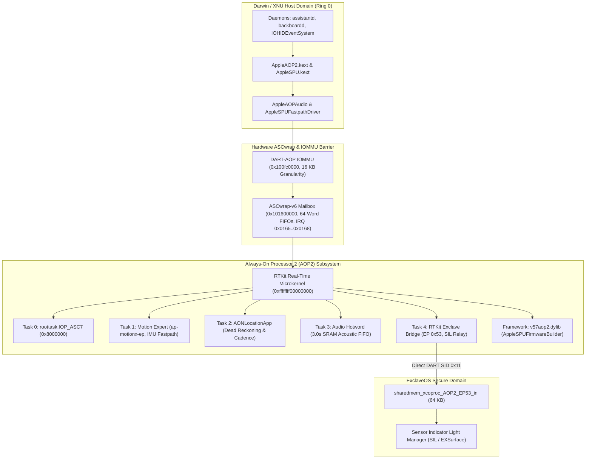

# Apple Always-On Processor 2 (AOP2), RTKit Microkernel & Sensor Hub Specification

[](#clean-room-statement)
[-orange.svg)](#key-invariants)
[](LICENSE)

An independent, clean-room architectural specification, real-time microkernel execution model, continuous sensor fusion pipeline, and ultra-low-power display/audio subsystem analysis for Apple's **Always-On Processor 2 (AOP2)** and **RTKitOS** on modern Apple Silicon (A19 Pro / `t8150` / iOS 27.2 Build `24B119`).

---

## Architecture Overview

The Always-On Processor 2 (AOP2) executes as an autonomous ultra-low-power subsystem on modern Apple Silicon SoCs (A19 Pro `t8150`). It executes a 64-bit preemptive microkernel (`RTKitOS / Yggdrasill`) compiled for **ARM64e with Pointer Authentication (PAC00)**, managing continuous background sensor awareness, low-power always-on display refresh, local hotword detection, and cross-enclave privacy telemetry while the host Application Processor (AP) CPU and GPU clusters sleep in retention states.



---

## Key Invariants & Parameters

| Parameter | Value | Description |
| :--- | :---: | :--- |
| **Target SoC** | `t8150` | Apple Silicon A19 Pro (`iPhone18,3` / `v57ap`) |
| **OS Version** | iOS 27.2 (`24B119`) | Darwin 24.2.0 |
| **AOP2 Container Tag** | `aop2` (`0x616f7032`) | Apple Image4 (`IM4P`) BUND container (5,603,353 B) |
| **BUND Format Version** | `0x00040000` (`DNUB`) | 11 memory segment mapping descriptors |
| **Embedded Sub-Binaries** | 7 Mach-O 64-bit | All compiled for ARM64e with Pointer Authentication (`PAC00`) |
| **RTKit Microkernel Base**| `0xffffffff00000000` | High-memory bare-metal preboot image (`MH_PRELOAD`) |
| **Primary ASCwrap Mailbox**| `0x0000000101600000` | 544 KB window (`0x88000`), 64-word bidirectional FIFO |
| **Doorbell Aggregation** | `0x000000010162c000` | High-speed multi-core doorbell trigger matrix |
| **Exclave Mailbox Proxy** | `0x000000035167c000` | SPTM Stage-2 hardware-protected secure mailbox proxy |
| **DART-AOP IOMMU** | `0x0000000100fc0000` | 48 KB range (`0xc000`), 16 KB pages, 9 active streams |
| **DART Host Stream** | SID `0x10` (`mapper-aop2`)| 1 MB shared fastpath sensor ring buffers (`_aop2_shm_reg`) |
| **DART Exclave Stream** | SID `0x11` (`mapper-exclave-aop2`)| Direct cross-enclave sensor privacy channel (`EP 0x53`) |
| **IMU Fastpath Record** | 64 Bytes | Cacheline-aligned 6-axis sample (timestamp, accel, gyro, temp) |
| **1Hz AOD Frame Buffer** | 262,144 Bytes (256 KB) | Direct Display Co-Processor (DCP) scanout buffer |
| **Siri Hotword FIFO** | 96,000 Bytes | 3.0s circular 16kHz 16-bit PCM buffer in retention SRAM (< 1.85 mW) |

---

## Repository Structure

```
.
├── README.md                           # This document
├── LICENSE                             # MIT License
├── docs/                               # Phase-by-phase findings & Master Dossier
│   ├── 01A_WORKSPACE_BASELINE.md       # BUND container layout & sub-binary inventory
│   ├── 01B_RTKIT_MICROKERNEL.md        # RTKit microkernel execution core & task topology
│   ├── 02_HARDWARE_AND_SENSOR_HUB.md   # MMIO registers, DART IOMMU, IMU fastpath, 1Hz AOD
│   ├── 03_ENDPOINT_WIRE_FORMAT.md      # 64-bit mailbox framing, opcodes, and Exclave RPC
│   ├── 04_XNU_DRIVER_BOUNDARY.md       # Darwin kext boundary, workloops, and entitlements
│   └── MASTER_DOSSIER.md               # Complete 56k+ byte definitive research dossier
├── specs/                              # Formal machine-readable JSON specifications
│   ├── phase_1a_workspace_baseline.json
│   ├── aop_firmware_container_spec.json
│   ├── rtkit_microkernel_spec.json
│   ├── aop_service_topology.json
│   ├── aop_hardware_registers.json
│   ├── sensor_hub_geometry.json
│   ├── rtkit_endpoint_wire_spec.json
│   ├── aop_mailbox_protocol.json
│   ├── xnu_aop_boundary_spec.json
│   └── cross_validation_matrix.json
├── runtime/                            # Clean-room standalone C client implementation
│   └── aop_rtkit_channel.c
└── tools/                              # Verification test suites
    └── verify_aop_constants.py
```

---

## Verification & Independent Replication

All invariants, MMIO addresses, and binary structures are backed by automated tests:

```bash
# 1. Run automated numerical verification suite
python3 tools/verify_aop_constants.py

# 2. Verify clean-room C client compiles cleanly
gcc -fsyntax-only -Wall -Wextra runtime/aop_rtkit_channel.c
```

---

## Clean-Room Statement

This research was conducted using clean-room reverse engineering methodology. All findings are derived exclusively from public IPSW restore images (`iPhone18,3_27.2_24B119_Restore`), decompressed Mach-O binaries, raw DeviceTree structures, and kernelcache string literals. No proprietary Apple source code, SDK private headers, or internal design documents were consulted.

---

## License

This project is licensed under the [MIT License](LICENSE).
